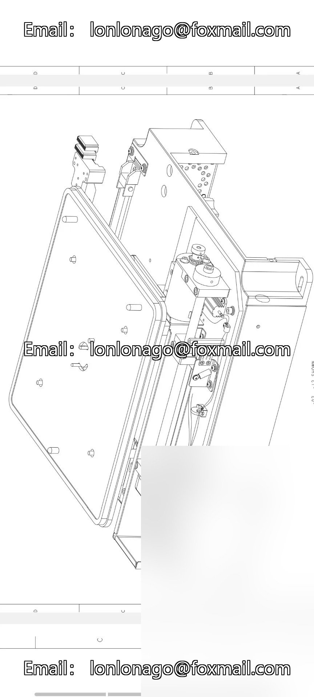
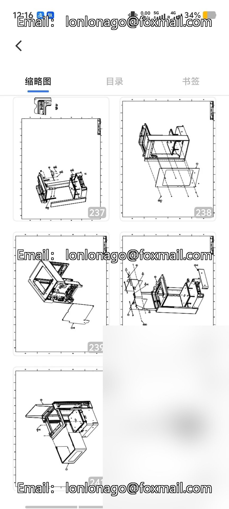
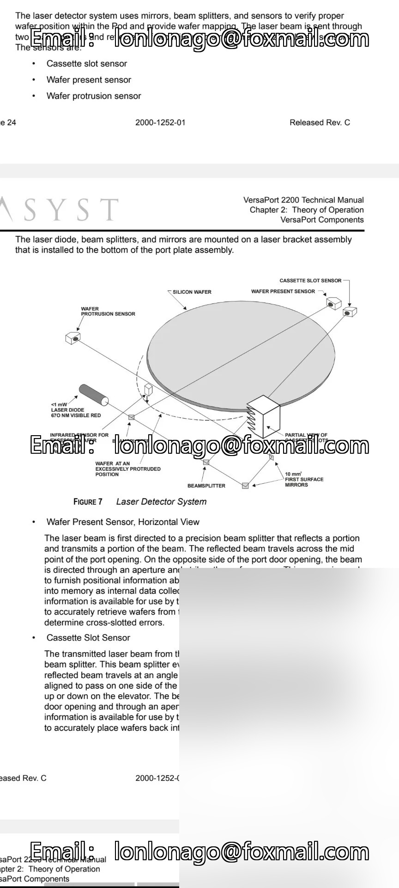
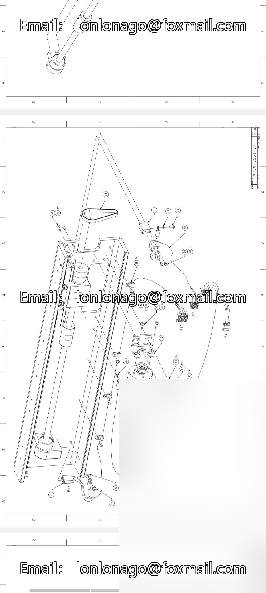
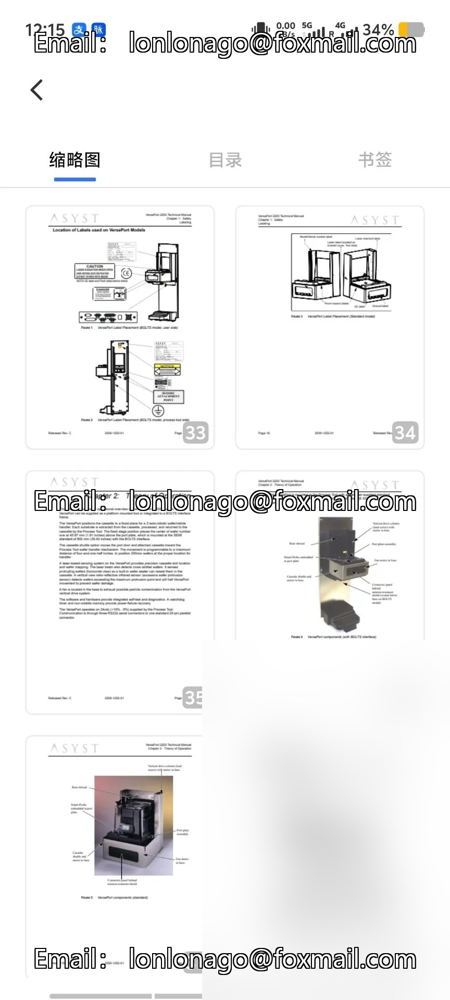

# Asyst Technologies (Aisi Technology) Versa

## Body

Asyst Technologies (ASYST Technologies) VersaPort 2200 equipment manual
PDF , high clarity, with table of contents, in English original.
Applicable to equipment maintenance, operation, and parts query.
non-refundable after sale.
Brand background: ASYST Technologies is a well-known equipment manufacturer in the semiconductor industry, specializing in automation material handling systems (AMHS) and process equipment interface solutions for wafer fab.

VersaPort 2200 is a fully automated wafer loading port or wafer processing program. It is mainly used in the cleanrooms of semiconductor manufacturing factories, responsible for the automatic loading and unloading of wafers in wafer trays (FOUP/Shelf) and interfacing with process equipment (such as etchers, deposition equipment, etc.).

The manual covers Asyst Technologies (Aisite Technology) VersaPort 2200; it offers equipment maintenance, operation and spare parts reference information along with technical parameters and operation explanations.

<!-- AI_ENRICHED -->

## Images

## Payment

Here is a pay link on Stripe ( https://buy.stripe.com/3cs8yP7sY87d0vu9AB ). Please contact me lonlonago@foxmail.com after funding $89, and I will send you a complete data files , thank you!

